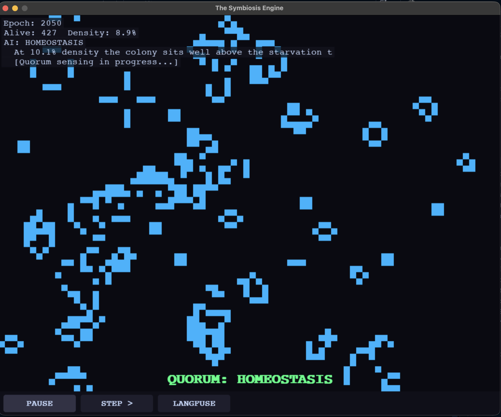
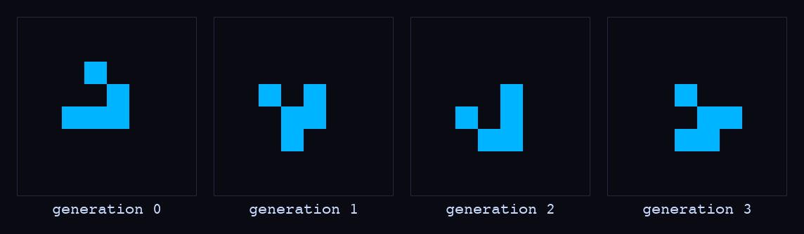
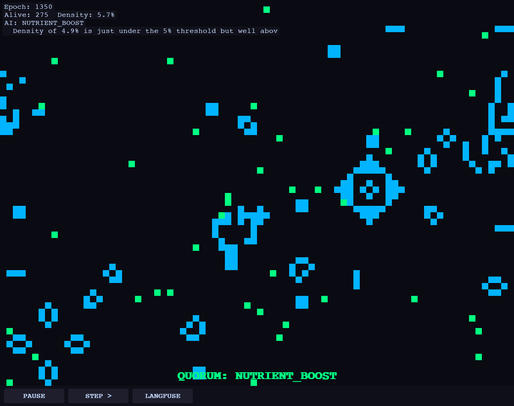
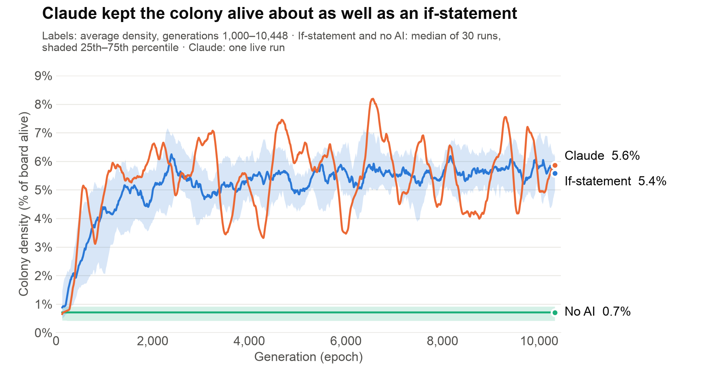

# The Symbiosis Engine

**A living simulation where an AI controls the weather, not the cells.**



<!-- demo video -->

## In 30 seconds

- **What it is:** a colony of cells running Conway's Game of Life, plus an AI agent (Claude, orchestrated with LangGraph) that checks on the colony every 50 generations and decides whether to feed it, cull it, or leave it alone.
- **The question:** can an AI that sees the whole board govern a colony better than a few simple rules?
- **The answer:** it did about as well as an `if` statement, and it was the only part of the system that made mistakes. I measured that, traced why, and presented it at **AWS Community Day Mumbai (October 2026)**.
- **Built with:** Python · NumPy · pygame · LangGraph · Claude · ClickHouse · Langfuse · Docker · pytest

---

## The tour

### 1. The cells follow four simple rules

Each cell looks only at its eight neighbours. A dead cell with exactly 3 live neighbours is born. A live cell with 2 or 3 survives. Every other live cell dies, from loneliness or overcrowding. That's the entire physics.

From those four rules, patterns appear that nobody programmed. The glider below crosses the board even though no individual cell ever moves:



This loosely mirrors real bacteria, which have no brain and react only to what touches them. The full biology mapping is in [REFERENCE.md](REFERENCE.md).

> **In the code:** [src/board.py](src/board.py). The whole update is about 10 lines of vectorized NumPy, with no loop over cells.

### 2. An AI controls the weather

Left alone, a colony collapses within a few hundred generations. So every 50 generations, an AI agent receives a summary of the colony and picks one environmental event:

| Event | When | What happens |
|---|---|---|
| Nutrient boost | colony is sparse (<5%) | food arrives and 40 new cells appear |
| Phage cull | colony is overcrowded (>40%) | a virus clears a 16 × 16 patch |
| Sporulation | colony is near extinction (<2%) | dormant spores scatter across the board |
| Homeostasis | otherwise | nothing |

The key design rule is that **the AI never changes how the cells behave.** It only changes the environment between generations, and the cells then carry on with the same four rules.



> **In the code:** [src/workflow.py](src/workflow.py) asks Claude for a decision. [src/interventions.py](src/interventions.py) applies it to the board. The AI call runs on a background thread so the animation never freezes.

### 3. Everything is recorded

- **ClickHouse** records what the colony did: population, births and deaths for every generation.
- **Langfuse** records what the AI thought: every prompt, response, its latency and cost.

Both run locally through Docker. The app still works without them.

### 4. The experiment: is the AI worth it?

I compared three ways of running the colony over about 10,000 generations:



| Policy | Average colony density | Source |
|---|---|---|
| No help at all | **0.8%**, the colony collapses | runner, median of 30 runs |
| A simple `if` statement using the same thresholds | **5.8%** | runner, median of 30 runs |
| Claude | **5.6%** | live runs |

The `if` statement and Claude finish level, which means the AI added cost and delay without adding control. Help is also only life support: switch it off halfway and density falls from 5.7% to 2.8%.

Anyone can reproduce the first two rows in about two minutes:

```bash
uv run python src/experiments.py
```

> **In the code:** [src/experiments.py](src/experiments.py) runs the same physics and interventions as the game, with no window and no AI, 30 times per policy with fixed seeds. The chart above is from the talk. The table comes from this runner, and the raw output is in [docs/evidence/](docs/evidence/README.md).

### 5. What went wrong, and what I learned

The cells applied their rules correctly every single generation. The AI was the only component that got things wrong, and the traces show how:

- **It acted on old news.** Decisions arrived 24–155 generations after the snapshot they were based on.
- **It reasoned confidently from wrong data.** In one trace it cited "ten consecutive interventions". There had been two.
- **Its output format was a request, not a guarantee.** Once in 20 calls, Claude put a sentence before its JSON, the parser rejected the reply, and a valid decision was silently dropped.

**The lesson I took from it:** the part that reasons is the part you have to trace.

---

## What this project shows

| Skill | Where to see it |
|---|---|
| Scientific Python and vectorization | [board.py](src/board.py): NumPy `np.roll` neighbour counting |
| AI agents and orchestration | [workflow.py](src/workflow.py): a LangGraph graph around Claude, with a safe fallback |
| Concurrency | [app.py](src/app.py): AI calls on a background thread inside a 15 FPS game loop |
| Observability | ClickHouse telemetry and Langfuse tracing, self-hosted with Docker Compose |
| Testing | [tests/](tests/): 27 pytest tests, including classic Game of Life patterns and boundary cases |
| Experiment design | [experiments.py](src/experiments.py): a control, a baseline and a withdrawal test, 30 seeded runs each |
| Honest evaluation | Every number in this README links to its evidence in [docs/evidence/](docs/evidence/README.md) |

---

## Run it yourself

You need Python 3.13, [uv](https://docs.astral.sh/uv/) and an Anthropic API key.

```bash
git clone https://github.com/RJSD3V/game0fAgents.git
cd game0fAgents
uv sync
cp .env.example .env          # add your ANTHROPIC_API_KEY

cd src && uv run python app.py
```

| Key | Action |
|---|---|
| `Space` | pause / resume |
| `→` | step one generation |
| `R` | restart with a new colony |
| `Esc` | quit |

**Optional extras:**
- `docker compose up -d` starts ClickHouse and Langfuse. The Langfuse dashboard is at http://localhost:3000.
- `uv run pytest` runs the tests.
- `uv run python src/experiments.py` runs the experiment.

---

## Codebase map

The files are small. Read them in this order:

| File | What it does |
|---|---|
| [src/board.py](src/board.py) | The physics: Conway's rules on a NumPy grid |
| [src/interventions.py](src/interventions.py) | The four environmental events |
| [src/workflow.py](src/workflow.py) | The AI agent: prompt, Claude call, response parsing |
| [src/app.py](src/app.py) | The game: main loop, rendering, controls, background AI calls |
| [src/experiments.py](src/experiments.py) | The headless experiment runner |
| [src/telemetry.py](src/telemetry.py) | Writing to and reading from ClickHouse |
| [tests/](tests/) | Tests for the physics, the events and the runner |
| [src/notebooks/game.ipynb](src/notebooks/game.ipynb) | The lab notebook where the NumPy approach was first worked out |

---

## What's next

- **Give the AI something rules can't do:** show it *where* the clusters are and whether its last decision worked.
- **Make sensing local, like real bacteria:** replace the single global observer with a chemical signal that spreads between neighbouring cells.
- **Enforce the AI's output format with a schema,** so a chatty reply can't drop a decision.

## Learn more

- [REFERENCE.md](REFERENCE.md): the biology behind every mechanic, with sources
- [TALK.md](TALK.md): the talk plan and engineering lessons
- [docs/evidence/](docs/evidence/README.md): test results, experiment output and raw AI logs
- [docs/BUG_REPORT_PROCESS.md](docs/BUG_REPORT_PROCESS.md): the debugging method I used

---

Built by [RJSD3V](https://github.com/RJSD3V) while learning Python, AI engineering and cell biology at the same time.
